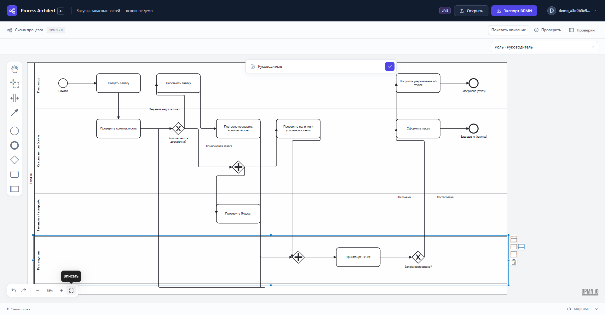

# Process Architect AI

Рабочее место аналитика, которое превращает русскоязычное описание процесса в **редактируемую BPMN 2.0 диаграмму**. LLM генерирует ограниченную Python-программу, а проверяемый детерминированный конвейер строит модель, XML и координаты элементов.



## Возможности

- Генерация BPMN по тексту, уточняющие вопросы и явные отказы для неподдерживаемого запроса.
- Задачи, дорожки, ветвления, параллельные потоки, циклы, взаимодействия участников и вложенные процессы.
- Документный каталог BPMN 2.0.2 по официальным XSD: события, транзакции, компенсации, данные, хореографии и разговоры.
- Графическое редактирование процессов в **bpmn-js** и отдельный редактор полного XML-документа с деревом, свойствами и DI-представлением.
- Экспорт текущего XML, повторный импорт и сохранение ручных ревизий.
- Сохранение исходного текста, Python, IR, XML и результатов проверок.
- Локальные аккаунты, серверные сессии и доступ пользователя только к собственным генерациям.

Это исследовательский прототип, созданный для хакатона. Соответствие диаграммы бизнес-смыслу проверяет аналитик; наличие корректного XML само по себе этого не доказывает.

## Как устроен конвейер

```text
Описание → LLM → ограниченный Python → изолированный worker
   → внутренняя модель → проверки → BPMN XML + DI → редактор → экспорт
```

Модель не пишет XML и не рассчитывает раскладку. AST-интерпретатор разрешает только вызовы BPMN Builder с литеральными аргументами. Отдельные проверки оценивают структуру, выбранные свойства поведения, XML по XSD и сохранность документа при передаче в редактор.

| Часть | Технологии |
|---|---|
| API и модель | Python 3.11, FastAPI, Pydantic, lxml |
| Интерфейс | TypeScript, React, Ant Design, Vite, bpmn-js |
| Исполнение | Отдельный worker с ограничениями Docker |
| Хранение | Локальные файлы артефактов, SQLite для аккаунтов и сессий |
| LLM | Настраиваемый Chat Completions API, отдельный профиль Yandex AI Studio |

## Быстрый запуск

Нужны **Git, Docker и Docker Compose** с работающим Docker daemon. Команды для PowerShell:

```powershell
git clone https://github.com/zanerybop/process-architect-ai.git
cd process-architect-ai
Copy-Item .env.example .env
docker compose up -d --build

# Создайте свой аккаунт; пароль вводится скрыто и не попадает в аргументы.
docker compose exec api python -m backend.app.manage_users create analyst
```

Откройте **http://127.0.0.1:8080**, войдите созданным аккаунтом, выберите встроенный пример и нажмите «Построить схему».

- API health: http://127.0.0.1:8000/api/health
- Документация API: http://127.0.0.1:8000/api/docs
- Логи: `docker compose logs -f api worker`
- Остановка с сохранением данных: `docker compose down`

Логин содержит 3–40 латинских букв, цифр или символов `.`, `_`, `-`; пароль — 10–128 символов. Самостоятельная регистрация отключена. Данные сохраняются в именованном томе `process_data`.

По умолчанию включён **`APP_MODE=mock`**: точные встроенные описания компилируются из заранее подготовленных программ. Это позволяет проверить приложение без ключа и модели. Произвольный новый текст возвращает `MOCK_UNKNOWN_TEXT`; демонстрационная схема не подставляется вместо ответа LLM.

## Подключить LLM

Заполните локальный `.env` параметрами своего совместимого провайдера:

```dotenv
APP_MODE=live
LLM_API_BASE_URL=https://your-provider.example/v1
LLM_API_KEY=
LLM_MODEL=
```

Ключ и точное имя модели нужно задать самостоятельно. Затем примените настройки:

```powershell
docker compose up -d --build api
```

| Настройка | Назначение |
|---|---|
| `LLM_DOCKER_API_BASE_URL` | Адрес, доступный API-контейнеру; для модели на хосте, например, `http://host.docker.internal:8080/v1` |
| `LLM_AUTH_SCHEME` | `auto`, `bearer` или `api_key` в соответствии с контрактом провайдера |
| `LLM_RESPONSE_FORMAT` | `json_object` или поддерживаемый провайдером `json_schema` |
| `LLM_TOKEN_PARAMETER` | `max_completion_tokens` либо `max_tokens` |
| `LLM_MAX_REPAIR_ATTEMPTS` | До двух исправляющих запросов при ошибках результата |
| `WEB_PORT` | Порт интерфейса; по умолчанию `8080` |

Полный шаблон — в [.env.example](.env.example), настройки Яндекса — в [config/yandex.env.example](config/yandex.env.example). Поддержку конкретной модели и формата ответа нужно проверять отдельно. При отсутствии настроек live возвращает ошибку; автоматического переключения на mock нет. Вызовы внешнего провайдера могут тарифицироваться.

## Разработка и проверки

Для локальных проверок нужны **Python 3.11, uv и Node.js 24**. Зависимости закреплены в `uv.lock`, `requirements.lock` и `frontend/package-lock.json`.

```powershell
uv sync --frozen
uv run pytest -q
uv run ruff check backend worker tests scripts

cd frontend
npm ci
npm run lint
npm run typecheck
npm test
npm run build
cd ..
```

Браузерные проверки запускают собственные API и UI с временным хранилищем:

```powershell
uv run python -m scripts.compile_fixtures
uv run python -m scripts.build_full_bpmn_fixtures
cd frontend
npx playwright install chromium
npm run test:browser
cd ..
```

Первые две команды создают тестовые BPMN из исходников в `examples/`; готовые артефакты не требуется хранить в Git. Для уже установленного совместимого Chromium можно задать `PLAYWRIGHT_CHROMIUM_EXECUTABLE`. Тесты выполняются последовательно, с отдельными аккаунтами и изолированным бюджетом попыток входа каждого аккаунта. Проверки production IP-ограничений находятся в Python-тестах. Браузерные тесты используют фикстуры и не оценивают качество реальной модели или изоляцию Docker.

Контейнерная проверка worker после запуска Compose: `uv run python -m scripts.container_check`. Проверки модели и браузерные live-smoke требуют отдельной настройки провайдера и тестового аккаунта; они не входят в автономные unit-тесты.

При подготовке публикации 8 ноября 2026 года на Windows прошли **999 Python-тестов и 53 браузерных теста** в Chromium, линтеры, TypeScript и сборка frontend. Конфигурация Compose проверена; контейнерный запуск не повторялся, поскольку локальный Docker daemon был выключен. Новых обращений к LLM в этих проверках не было.

## Ограничения и безопасность

Официальный каталог BPMN доступен для построения и сохранения документов. Исполняющего BPMN-движка нет, все сочетания конструкций не проверены. Графический Modeler используется только при безопасном round-trip; хореографии и разговоры открываются в документном режиме. Расширенный анализ поведения может вернуть `inconclusive`.

Ограничения ресурсов: описание до 20 000 символов, Python до 65 536 байт, до 1 200 вызовов Builder и 2 500 элементов документа. Произвольные `exec/eval`, импорты и доступ к файловой системе из сгенерированной программы запрещены. При недоступном worker приложение не включает небезопасный локальный обход.

Прототип рассчитан на контролируемый запуск. Для открытого размещения необходима отдельная эксплуатационная настройка и проверка безопасности. Закрытые регламенты нельзя отправлять внешнему провайдеру без разрешения владельца данных.

## Структура и документация

| Путь | Содержимое |
|---|---|
| `backend/`, `worker/` | API, Builder, проверки, сериализация и изолированное выполнение |
| `frontend/` | Редактор и браузерные тесты |
| `examples/` | Синтетические описания, программы и корпуса проверок |
| `schemas/` | Официальные BPMN XSD с указанием источников |
| `scripts/`, `tests/` | Проверки, бенчмарки и служебные инструменты |
| `docs/` | Архитектура, контракт, безопасность и ограничения |

- [Архитектура](docs/ARCHITECTURE.md)
- [Контракт BPMN API](docs/03_BPMN_API_CONTRACT.md)
- [Безопасность](docs/SECURITY.md)
- [Ограничения](docs/LIMITATIONS.md)
- [Примеры](examples/README.md), [источники схем и материалов](references/SOURCES.md)

В репозиторий включены исходники, тесты, lock-файлы, примеры и один скриншот интерфейса. Ключи, аккаунты, сессии, локальные бизнес-данные, окружения, записи, сборки и архивы поставки исключены.
